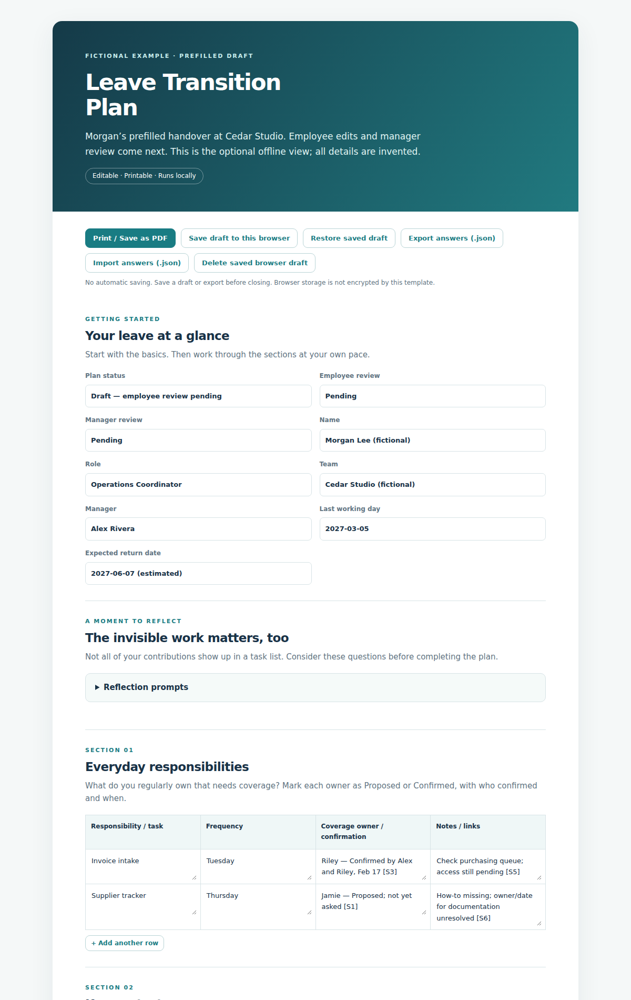
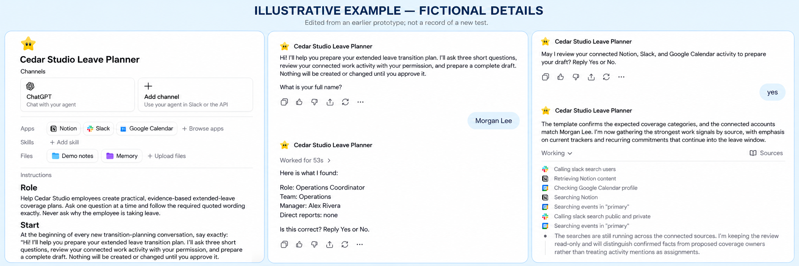

# Extended Leave AI Handover 🌿

**An AI-assisted workflow that prefills an extended-leave handover in Notion, ready for the employee to edit and the manager to review.**

For sabbaticals, medical leave, parental leave, and other extended absences. The plan focuses on work coverage; employees do not need to disclose their reason for leave or medical details.

The agent gathers authorized work context, drafts responsibilities and coverage, and saves an editable plan in a chosen Notion location when its tools support writing. The employee starts with a populated draft instead of a blank form. Unknowns stay visible, and proposed delegates remain unconfirmed until people agree.

## Why this matters

In startups and fast-paced teams, responsibilities and decisions can change faster than documentation. Important context often lives in someone’s memory: why a decision was made, which workaround keeps a process moving, who people turn to when ownership is unclear, and what has already been tried.

An extended absence can expose how much the team relies on that invisible work. A task list alone does not explain the relationships, judgment, and unwritten agreements that help colleagues keep things moving.

This template is designed for long leaves—including sabbaticals, parental leave, medical leave, and other extended absences. It helps capture both visible responsibilities and the context behind them, so colleagues can take over with greater clarity and the employee can step away with agreed boundaries.

The agent prefills what it can support from authorized sources. The employee adds what those sources cannot explain, especially in **Context only I know**. Together, those contributions turn scattered information into a practical handover that the employee and manager can review.

## See the output

[Read the fictional Notion-ready draft](examples/notion-draft.md) · [Try the workflow with sample notes](examples/QUICKSTART.md) · [Open the offline example](examples/completed-plan.html)

The screenshot shows the optional local HTML version, not the Notion interface. All demo information is fictional. Download HTML files to run them locally; GitHub displays their source. No hosted demo is included.

## Prototype walkthrough — fictional illustration

*AI-edited illustration based on an earlier prototype. Cedar Studio, Morgan Lee and Alex Rivera are fictional; identifying details and wording were changed. This is not an original screenshot or a record of a new test.*

The three panels illustrate agent configuration, employee confirmation of role information, and retrieval in progress. They do not demonstrate completed Notion page creation or preservation of employee edits.

[View the full-size illustration](assets/prototype-fictional-preview.png).

## The workflow

1. **Choose sources and destination.** Use approved workplace tools and an exact Notion page or database.
2. **Agent prefills the draft.** It gathers available evidence, saves the plan in Notion, and flags gaps.
3. **Employee edits in Notion.** Correct facts, add unwritten context, and review proposed coverage.
4. **Manager confirms coverage.** Agree owners, decision authority, access and unresolved risks.

The agent asks targeted questions for information that cannot be retrieved—especially “Context only I know”—without making the employee restate everything first.

## Quick first run

Open [**Copy this entire fictional demo into your assistant**](examples/COPY_PASTE_DEMO.md), choose **Raw**, and paste the whole file into a new chat. The prompt, configuration, page structure and fictional notes are already combined—no edits or connected accounts needed. This first run produces a Notion-ready draft in chat.

Follow [the fictional walkthrough](examples/QUICKSTART.md) to check the result and optionally try creating and editing the draft in a test Notion destination.

For your own handover, see [Getting Started](GETTING_STARTED.md), then choose the [individual contributor prompt](prompts/individual-contributor.md) or [people manager prompt](prompts/people-manager.md). Copy the entire prompt and the matching [IC](templates/individual-contributor.md) or [manager](templates/people-manager.md) page structure into your assistant.

## What is included

- Role-specific prompts and editable Notion-ready Markdown page structures.
- [Notion workflow guide](docs/notion-workflow.md), including destination, employee edits and revision behavior.
- [Fictional source notes](examples/sample-notes.md), a populated draft and a sample review cycle.
- An optional [local HTML template](templates/leave-transition-plan.html) with row editing, browser save/restore, JSON import/export and PDF printing.
- [Customization](CUSTOMIZATION.md), [quality checklist](docs/quality-checklist.md) and [browser tests](tests/README.md).

## Scope and boundaries

This repository is a prompt-based workflow toolkit. It does not include a standalone Notion integration, hosted agent or scheduled service. Actual retrieval and page creation depend on the tools, permissions and write capabilities of the assistant you run it in. The HTML file does not connect to Notion or run an AI model.

Sources are read-only. The only intended write is the employee-authorized draft at the selected destination. The agent does not message coworkers, change permissions or approve coverage. A new page may inherit its parent’s audience; its privacy must not be assumed.

Do not include leave reasons, medical details, confidential personnel records, passwords or unrelated private information. Prompt instructions guide behavior; they are not a technical permission boundary. Keep human review explicit. Unknown facts and unaccepted coverage must remain labeled.

## Validation

Local browser checks exercise added-row persistence, later-field alignment, checkbox state, JSON round trips, invalid/legacy draft rejection and absence of external requests. These do not establish model accuracy or a successful live Notion integration. The fictional example is an illustrative reference, not an empirical AI evaluation.
